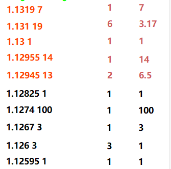

# Ironbeam API Integration Sample

This repository contains a **sanitized extraction of the Ironbeam API calling layer** from a C# trading application.

The purpose is to give developers a small, focused starting point for:

- Ironbeam authentication
- Creating a market-data stream
- WebSocket market-data connection
- Quote / depth / trade subscriptions
- Historical quotes / depth / trades
- Order placement
- Reading open (`NEW`) orders
- Batch order cancellation
- Logout

**Trading strategy, signal generation, WinForms UI, DOM/WebView code, and account credentials are intentionally excluded.**

## Security

**Never commit real Ironbeam credentials to GitHub.**

The original application contained credentials. They have been removed from this repository. If credentials from the original application were ever exposed outside the private environment, rotate/revoke them before publishing code.

Use environment variables, user secrets, a secret manager, or another secure configuration mechanism.

Example:

```text
IRONBEAM_USERNAME=...
IRONBEAM_PASSWORD=...
IRONBEAM_API_KEY=...
IRONBEAM_ACCOUNT_ID=...
```

## Architecture

```text
                    +----------------------+
                    |  Ironbeam REST API   |
                    +----------+-----------+
                               |
                 Authentication / Stream
                               |
                               v
                    +----------------------+
                    |  Session Token       |
                    |  Stream ID           |
                    +----------+-----------+
                               |
                 +-------------+-------------+
                 |                           |
                 v                           v
        REST market endpoints        WebSocket stream
        quotes / depth / trades             |
                                            v
                                  real-time market data
```

Typical initialization:

```text
Authenticate
    ↓
CreateStream
    ↓
SubscribeQuotes / SubscribeDepths / SubscribeTrades
    ↓
Connect WebSocket
    ↓
Process incoming messages
```

## Endpoints used by the source project

### Authentication

```http
POST /v2/auth
```

Request body:

```json
{
  "Username": "YOUR_USERNAME",
  "Password": "YOUR_PASSWORD",
  "ApiKey": "YOUR_API_KEY"
}
```

The response contains a session token.

### Create stream

```http
GET /v2/stream/create
Authorization: Bearer <session-token>
```

The response contains a `streamId`.

### Real-time WebSocket

The source project uses:

```text
wss://live.ironbeamapi.com/v2/stream/{streamId}
```

For demo environments, use the corresponding demo endpoint supplied by Ironbeam.

### Market-data subscriptions

```http
GET /v2/market/quotes/subscribe/{streamId}?symbols=...
GET /v2/market/depths/subscribe/{streamId}?symbols=...
GET /v2/market/trades/subscribe/{streamId}?symbols=...
Authorization: Bearer <session-token>
```

The source project uses exchange-qualified symbols such as:

```text
XCME:6E.M25
```

The exact exchange, symbol and contract month should be supplied according to the account/data entitlement and Ironbeam's current API requirements.

### Market depth example

The following screenshot shows an example of the market-depth data used by the application. It is included to make the expected depth/price-level information easier to understand.



### Historical market data

Quotes:

```http
GET /v2/market/quotes?symbols=...
Authorization: Bearer <session-token>
```

Depth:

```http
GET /v2/market/depth?symbols=...&from=...&to=...&max=...&earlier=...
Authorization: Bearer <session-token>
```

Trades:

```http
GET /v2/market/trades/{symbol}/{from}/{to}/{max}/{earlier}
Authorization: Bearer <session-token>
```

## Orders

The source project contains the following order operations.

### Place order

```http
POST /v2/order/{accountId}/place
Authorization: Bearer <session-token>
Content-Type: application/json
```

Example payload:

```json
{
  "accountId": "ACCOUNT_ID",
  "exchSym": "XCME:SYMBOL.CONTRACT",
  "side": "BUY",
  "quantity": 1,
  "limitPrice": 0,
  "orderType": "MARKET",
  "duration": "0",
  "waitForOrderId": true
}
```

The exact payload requirements should be verified against the current Ironbeam API documentation before production use.

### Get NEW orders

```http
GET /v2/order/{accountId}/NEW
Authorization: Bearer <session-token>
```

The source project filters the returned `orders` array for:

```json
{
  "status": "NEW",
  "orderId": "..."
}
```

### Cancel multiple orders

```http
DELETE /v2/order/{accountId}/cancelMultiple
Authorization: Bearer <session-token>
Content-Type: application/json
```

Payload:

```json
{
  "accountId": "ACCOUNT_ID",
  "orderIds": [
    "ORDER_ID_1",
    "ORDER_ID_2"
  ]
}
```

## Minimal usage

```csharp
using IronbeamApiSample;

var api = new IronbeamApiClient();

await api.AuthenticateAsync(
    Environment.GetEnvironmentVariable("IRONBEAM_USERNAME"),
    Environment.GetEnvironmentVariable("IRONBEAM_PASSWORD"),
    Environment.GetEnvironmentVariable("IRONBEAM_API_KEY"));

await api.CreateStreamAsync();

await api.SubscribeTradesAsync("XCME:6E.M25");

using var ws = api.CreateStreamWebSocket();

await ws.ConnectAsync(
    api.GetStreamWebSocketUri(),
    CancellationToken.None);

// Receive and process Ironbeam WebSocket messages here.
```

## What a developer needs to implement

The extracted client deliberately stops before application-specific processing.

A developer joining the project would need to implement:

1. WebSocket receive loop
2. Fragmented WebSocket message handling
3. Ironbeam message deserialization
4. Quote/trade/depth event routing
5. Reconnection and stream recreation
6. Session-token refresh
7. Error handling and logging
8. Order lifecycle handling
9. Thread-safe handoff to the trading engine
10. Unit/integration tests

## Performance considerations

The original application is latency-sensitive.

For high-frequency market-data processing:

- Avoid creating a new `HttpClient` per market-data message.
- Keep REST calls out of the WebSocket receive loop.
- Reuse buffers.
- Handle fragmented WebSocket messages correctly.
- Avoid UI updates for every tick.
- Avoid unnecessary JSON-to-dynamic conversions.
- Consider `Utf8JsonReader` or a specialized parser for hot paths.
- Keep strategy processing separate from network I/O.
- Use timestamps supplied by the market-data stream rather than UI timestamps where appropriate.

A recommended architecture is:

```text
WebSocket Receive
       ↓
Fast Parser
       ↓
Normalized MarketData Event
       ↓
Trading Engine
       ↓
Order Manager
       ↓
Ironbeam REST Order API
```

## Ironbeam API Integration Support

If you are looking for a developer to integrate the **Ironbeam API** into a C#/.NET trading application, I can provide technical support based on this existing implementation.

Areas include:

- Ironbeam API authentication
- REST API integration
- Real-time WebSocket market data
- Quotes, trades, and market depth
- Order placement and cancellation
- Account and order management
- C# / .NET integration
- Market-data parsing and processing

This repository demonstrates the existing Ironbeam API integration and can be used as a starting point for further development or integration into an existing trading system.

**Need help integrating Ironbeam API with a C#/.NET trading application? Feel free to contact me.**

## Project scope

This repository is intended as an **API integration / developer collaboration sample**, not as a complete trading strategy.

It intentionally does not contain:

- account passwords
- API keys
- session tokens
- proprietary signal logic
- HIGH/LOW strategy logic
- WinForms controls
- WebView2 code
- private trading logs
- personal account information

## Important

Ironbeam API endpoints and payload requirements can change. Before using this code with a live account, verify the current API specification and test against the appropriate demo environment.

This repository is not affiliated with or endorsed by Ironbeam unless explicitly stated by the repository owner.
